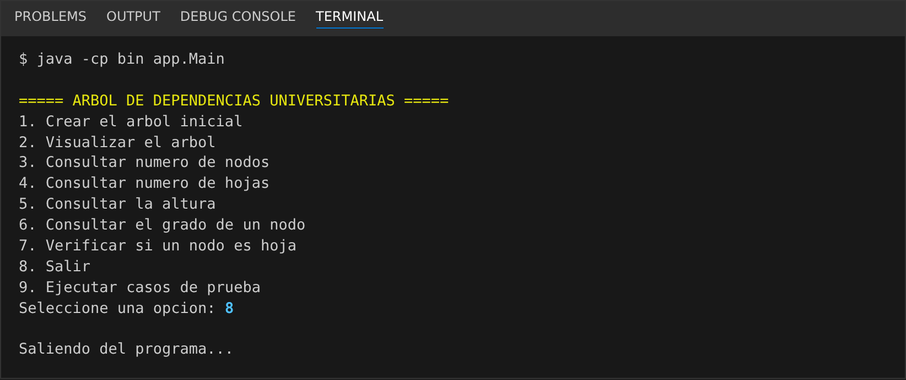
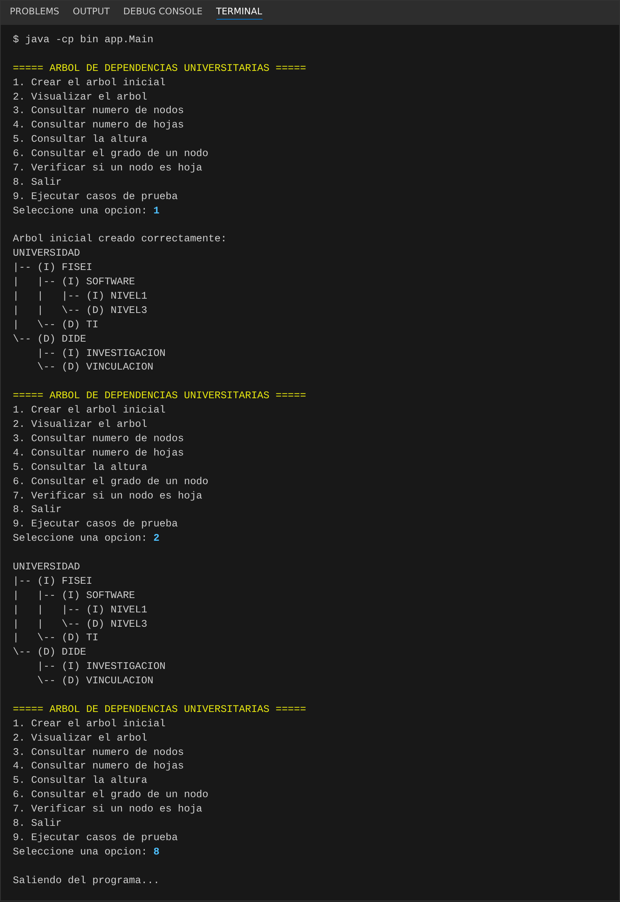
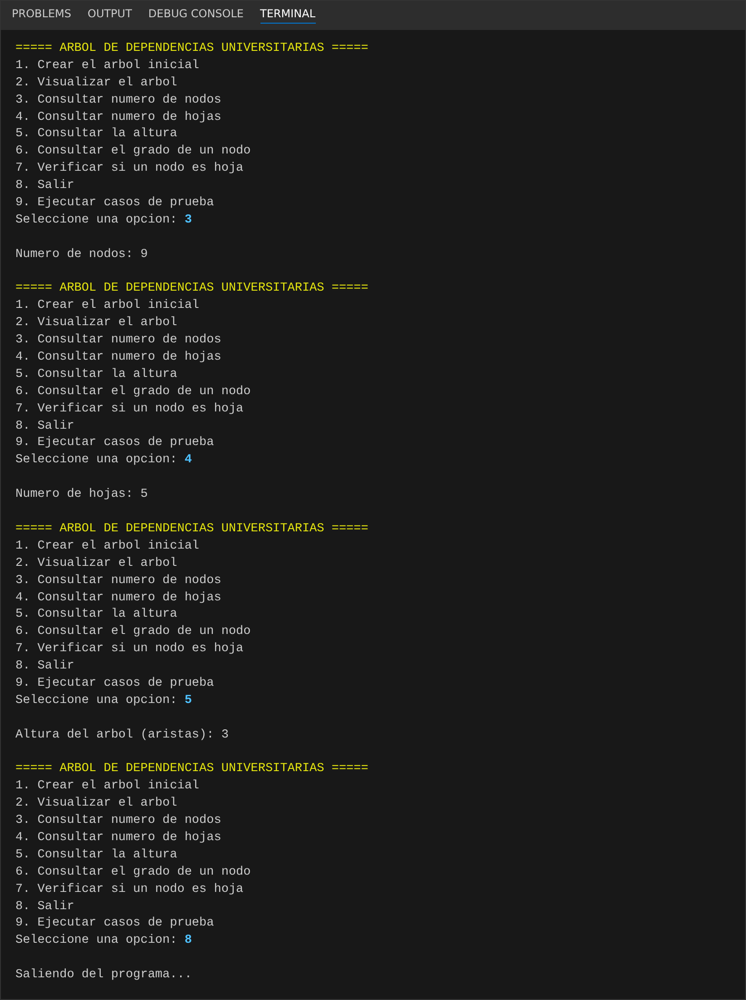
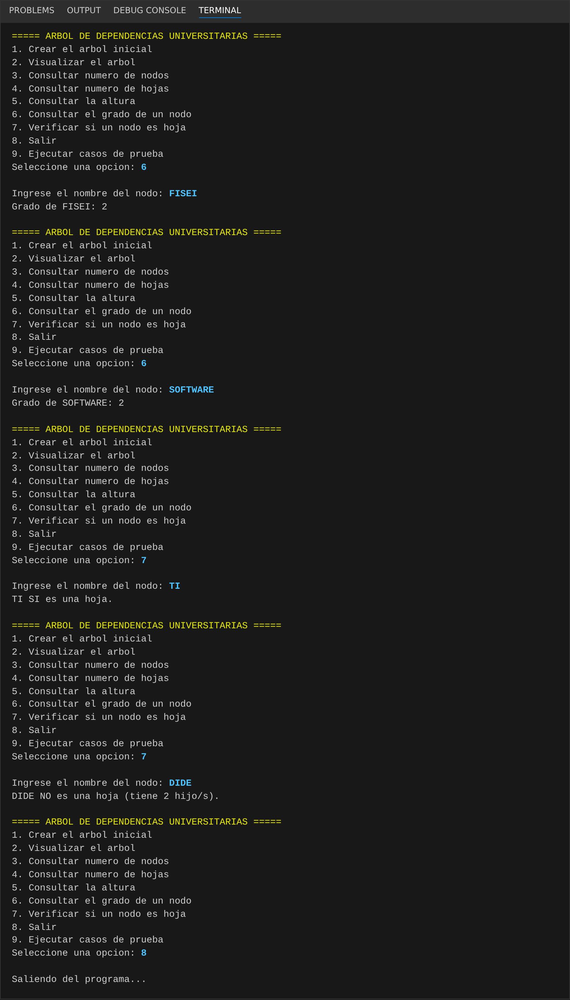
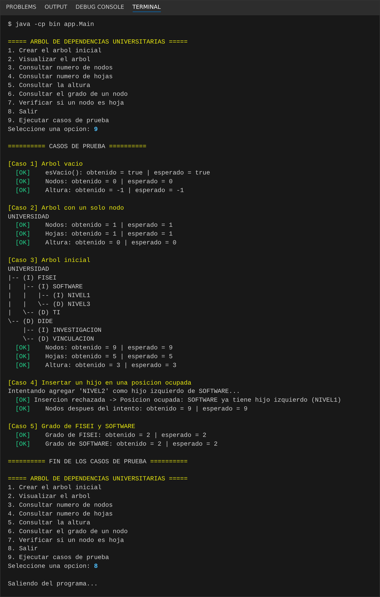

# T6 – Árbol Binario en Java

**Asignatura:** Estructura de Datos · **Docente:** Ing. José Caiza, Mg.
**Estudiante:** Tenorio Ronquillo Jonathan Sebastián · Software – Tercero "B" · Universidad Técnica de Ambato

---

## 1. Problema

La Universidad necesita representar la organización jerárquica de sus dependencias académicas. Cada dependencia es un **nodo** que guarda su nombre y puede tener **como máximo dos hijos** (izquierdo y derecho), por lo que la estructura adecuada es un **árbol binario**.

El programa permite construir el árbol, visualizarlo en consola y analizarlo: número de nodos, número de hojas, altura, grado de un nodo y si un nodo es hoja.

## 2. Estructura del árbol

```
             UNIVERSIDAD
             /         \
        FISEI           DIDE
        /   \           /   \
  SOFTWARE   TI   INVESTIGACION  VINCULACION
    /   \
 NIVEL1 NIVEL3
```

| Propiedad | Valor |
|---|---|
| Nodos | 9 |
| Hojas | 5 (NIVEL1, NIVEL3, TI, INVESTIGACION, VINCULACION) |
| Altura (en aristas) | 3 (UNIVERSIDAD → FISEI → SOFTWARE → NIVEL1) |

> Los nombres se escriben sin tildes ("INVESTIGACION", "VINCULACION") para evitar problemas de codificación en la consola de Windows.

## 3. Organización del proyecto

```
src/
 ├── modelo/
 │    └── Nodo.java          → Nodo genérico: dato, izquierdo, derecho, esHoja(), grado()
 ├── negocio/
 │    └── ArbolBinario.java  → Inserción, conteos recursivos, altura, búsqueda y visualización
 └── app/
      └── Main.java          → Menú interactivo con Scanner y casos de prueba
```

### Operaciones implementadas

| Método | Descripción | Implementación |
|---|---|---|
| `crearRaiz(dato)` | Crea la raíz (error si ya existe) | Directa |
| `agregarIzquierdo(padre, dato)` | Agrega hijo izquierdo (error si la posición está ocupada) | Directa |
| `agregarDerecho(padre, dato)` | Agrega hijo derecho (error si la posición está ocupada) | Directa |
| `contarNodos()` | `0` si el nodo es null; si no `1 + izq + der` | **Recursiva** |
| `contarHojas()` | `1` si el nodo es hoja; si no `hojas(izq) + hojas(der)` | **Recursiva** |
| `altura()` | `-1` si el nodo es null; si no `1 + max(alt(izq), alt(der))` | **Recursiva** |
| `esVacio()` | `raiz == null` | Directa |
| `mostrarArbol()` | Dibuja el árbol en consola con ramas `(I)` / `(D)` | Recursiva |
| `buscar(texto)` | Localiza un nodo por nombre (para consultar grado / hoja) | Recursiva |

No se utilizan `TreeSet`, `TreeMap`, `PriorityQueue`, `NavigableSet` ni `NavigableMap`.

## 4. Instrucciones de ejecución

**Requisitos:** JDK 17 o superior.

**Desde VS Code:** abrir la carpeta del proyecto (con *Extension Pack for Java* instalado), abrir `src/app/Main.java` y presionar **Run**.

**Desde la terminal** (en la raíz del proyecto):

```bash
javac -d bin src/modelo/Nodo.java src/negocio/ArbolBinario.java src/app/Main.java
java -cp bin app.Main
```

### Menú

```
===== ARBOL DE DEPENDENCIAS UNIVERSITARIAS =====
1. Crear el arbol inicial
2. Visualizar el arbol
3. Consultar numero de nodos
4. Consultar numero de hojas
5. Consultar la altura
6. Consultar el grado de un nodo
7. Verificar si un nodo es hoja
8. Salir
9. Ejecutar casos de prueba
```

## 5. Resultados

### Visualización del árbol inicial

```
UNIVERSIDAD
|-- (I) FISEI
|   |-- (I) SOFTWARE
|   |   |-- (I) NIVEL1
|   |   \-- (D) NIVEL3
|   \-- (D) TI
\-- (D) DIDE
    |-- (I) INVESTIGACION
    \-- (D) VINCULACION
```

### Casos de prueba obligatorios

| # | Caso | Esperado | Obtenido |
|---|---|---|---|
| 1 | Árbol vacío | 0 nodos, altura -1 | ✅ 0 nodos, altura -1 |
| 2 | Árbol con un solo nodo | 1 hoja, altura 0 | ✅ 1 hoja, altura 0 |
| 3 | Árbol inicial | 9 nodos, 5 hojas, altura 3 | ✅ 9 nodos, 5 hojas, altura 3 |
| 4 | Insertar hijo izquierdo en SOFTWARE (ya ocupado) | Inserción rechazada | ✅ "Posicion ocupada: SOFTWARE ya tiene hijo izquierdo (NIVEL1)" |
| 5 | Grado de FISEI y SOFTWARE | 2 y 2 | ✅ 2 y 2 |

## 6. Capturas de pantalla


**Menú principal**


**Árbol inicial (opción 1 y 2)**


**Consultas de nodos, hojas y altura (opciones 3, 4 y 5)**


**Grado y verificación de hoja (opciones 6 y 7)**


**Casos de prueba (opción 9)**

